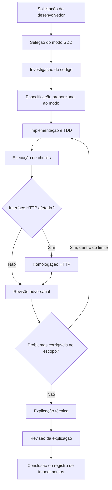
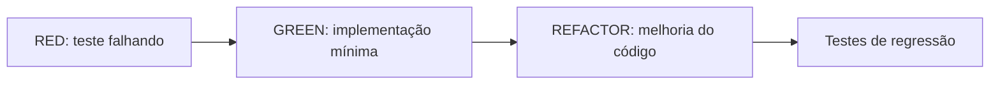

# Guia de utilização das skills do harness

O harness possui oito skills, divididas em dois grupos: quatro skills que determinam **como o agente trabalha** e quatro adaptadores que determinam **o nível de formalização, documentação e verificação da tarefa (SDD)**.

No desenvolvimento cotidiano, utilize principalmente os modos SDD, deixando o coordenador acionar as demais skills conforme necessário. As skills especializadas também podem ser invocadas diretamente.

Este guia considera a skill `verified-development` versão 0.9.2. Os arquivos [SKILL.md](../skills/) e a configuração do projeto definem o comportamento efetivo.

## 1. Modos SDD

SDD (*Specification-Driven Development*) é o desenvolvimento orientado por especificações. O harness oferece três modalidades efetivas e um seletor automático.

| Skill | Uso recomendado | Sobrecarga relativa esperada |
| --- | --- | --- |
| `$sdd-off` | Alterações triviais e pontuais | Menor |
| `$sdd-lite` | Bugs e funcionalidades de baixa complexidade | Baixa a moderada |
| `$sdd-full` | Funcionalidades complexas, críticas ou arquiteturais | Alta |
| `$sdd-auto` | Quando não souber qual modalidade utilizar | Variável |

### `$sdd-off` — SDD desativado

Recomendado para correções de textos, ajustes de CSS e estilização, renomeação de variáveis, alterações pontuais de componentes e pequenas refatorações de baixo risco que não justifiquem documentação permanente.

```text
$sdd-off Altere a cor do botão de confirmação
de entrega e aumente seu espaçamento interno.
```

O agente não cria documentação de tarefa nem atualiza os arquivos de memória do harness. Entretanto, continua realizando investigação, testes, verificações pertinentes e explicação técnica proporcional à alteração. O coordenador também solicita revisão independente do código e da explicação, declarando eventual indisponibilidade. Os resultados dos checks permanecem em `.harness/results/`.

**Desativar o SDD não significa desativar todas as verificações.**

Fonte: [sdd-off/SKILL.md](../skills/sdd-off/SKILL.md).

### `$sdd-lite` — SDD simplificado

Recomendado para correções de bugs com escopo delimitado, pequenas funcionalidades, regras de negócio simples, refatorações localizadas e tarefas que precisam de rastreabilidade sem uma especificação extensa.

```text
$sdd-lite Corrija a inconsistência entre a numeração
dos pins do mapa e a ordem da lista de entregas.
```

Cria a seguinte estrutura (identificador e slug ilustrativos):

```text
.harness/
└── tarefas/
    └── 001-corrigir-numeracao-pins/
        ├── meta.json
        └── tarefa.md
```

O arquivo `tarefa.md` reúne objetivo, critérios de aceite, passos de implementação e verificações. O agente também pode atualizar a memória do projeto e registrar problemas relevantes descobertos durante o trabalho.

**Recomendação:** utilizar lite como padrão para a maior parte das tarefas cotidianas que precisam de rastreabilidade, sem a documentação extensa do modo full. Investigação, checks, revisão independente e explicação técnica continuam fazendo parte do fluxo.

Fonte: [sdd-lite/SKILL.md](../skills/sdd-lite/SKILL.md).

### `$sdd-full` — SDD completo

Recomendado para implementações complexas, alterações arquiteturais, substituição de bibliotecas ou serviços externos, mudanças em contratos de APIs, funcionalidades envolvendo segurança ou integridade de dados, alterações com impacto financeiro e tarefas extensas que precisarão ser retomadas em outras sessões.

```text
$sdd-full Substitua as APIs Google Distance Matrix
e Directions por uma solução baseada em Haversine
e OSRM, preservando as funcionalidades existentes.
```

Cria a seguinte estrutura (identificador e slug ilustrativos):

```text
.harness/
└── tarefas/
    └── 002-substituir-google-maps/
        ├── meta.json
        ├── spec.md
        ├── plan.md
        └── tasks.md
```

| Arquivo | Finalidade |
| --- | --- |
| `spec.md` | Requisitos e critérios de aceite |
| `plan.md` | Estratégia técnica e verificações planejadas |
| `tasks.md` | Passos de implementação e respectivas evidências |
| `meta.json` | Estado, identificação e metadados da tarefa |

Exige rastreabilidade entre requisitos, critérios de aceite, implementação e evidências de testes, com validação do contrato e avaliação por critério.

A revisão adversarial independente do código e da explicação técnica é **obrigatória por padrão**. Sem ela, a tarefa não pode ser formalmente marcada como verificada ou concluída, salvo dispensa explícita autorizada. A dispensa não substitui evidências nem aprova critérios pendentes.

É a modalidade mais rigorosa e potencialmente mais onerosa em tokens.

Fonte: [sdd-full/SKILL.md](../skills/sdd-full/SKILL.md).

### `$sdd-auto` — Seleção automática

O agente avalia a tarefa e escolhe entre lite e full, considerando onze dimensões:

| Dimensão | O que é avaliado |
| --- | --- |
| `behavior` | Impacto no comportamento existente |
| `feature` | Novidade funcional |
| `contract` | Contratos e interfaces |
| `data` | Manipulação e integridade dos dados |
| `security` | Segurança |
| `service_cost` | Custo de serviços externos |
| `volume` | Volume de código afetado |
| `complexity` | Complexidade da implementação |
| `architecture` | Impacto arquitetural |
| `reversibility` | Facilidade de reversão |
| `test_scope` | Abrangência dos testes necessários |

```text
$sdd-auto Implemente um mecanismo de cache
para os cálculos de distância entre entregas.
```

Se houver risco material ou avaliação incompleta, o harness selecionará full. Lite é selecionado quando as dimensões forem devidamente avaliadas como de impacto baixo ou inexistente.

**Importante:** o modo automático nunca seleciona off.

Fonte: [sdd-auto/SKILL.md](../skills/sdd-auto/SKILL.md).

## 2. Skills operacionais

Estas skills são responsáveis pela execução técnica do trabalho. Podem ser invocadas diretamente, mas normalmente são acionadas pelo coordenador.

### `$verified-development` — Coordenador principal

É a skill central do harness. Coordena preparação e migração dos controles locais quando aplicável, investigação, implementação, testes, homologação HTTP, revisão adversarial, documentação e explicação técnica.

Fluxo resumido (o modo escolhido determina a documentação e as exigências de conclusão):



Pode ser invocada diretamente:

```text
$verified-development Implemente notificações
quando uma nova entrega for atribuída ao motoboy.
```

Nesse caso, utiliza a última escolha explícita do usuário, o modo registrado na tarefa retomada ou, para uma nova tarefa sem preferência explícita, o modo configurado no projeto. Na ausência de configuração, utiliza auto.

A explicação técnica final deve identificar o comportamento anterior e o novo, arquivos e funções reais, sequência de operações, razões das decisões, consequências técnicas e operacionais, pontos para inspeção humana, evidências e limitações. Por exemplo, se uma função realiza três chamadas a uma API externa, deve identificar as condições dessas chamadas, seu motivo e impacto potencial, distinguindo estimativas de faturamento real.

Fonte: [verified-development/SKILL.md](../skills/verified-development/SKILL.md).

### `$code-investigation` — Investigação de código

Recomendada quando se deseja compreender o código **sem modificá-lo**.

| Situação | Aplicabilidade |
| --- | --- |
| Investigar a origem de um bug | Sim |
| Compreender código gerado por IA | Sim |
| Identificar chamadas redundantes de API | Sim |
| Mapear dependências entre funções | Sim |
| Investigar possíveis regressões | Sim |
| Implementar uma correção | Não |

```text
$code-investigation Investigue todas as chamadas
à API Distance Matrix realizadas a partir da rota
POST /box/daily-code.

Identifique as funções envolvidas, as condições
de execução e a quantidade de elementos calculados
em função do número de entregas.
```

O agente entrega um diagnóstico com referências ao código, dependências, riscos, evidências, testes relevantes e hipóteses ainda não verificadas. Pode executar verificações de diagnóstico não destrutivas quando seguro, mas não modifica código nem prepara ambiente por conta própria.

Essa skill é particularmente útil para compreender código produzido por agentes, em vez de simplesmente delegar sucessivas implementações.

Fonte: [code-investigation/SKILL.md](../skills/code-investigation/SKILL.md).

### `$tdd-implementation` — Implementação orientada por testes

Recomendada quando o problema já foi compreendido e se deseja conduzir a implementação por testes automatizados.

Segue o ciclo clássico de TDD (*Test-Driven Development*), precedido pela identificação e execução dos testes existentes pertinentes (baseline).



```text
$tdd-implementation Corrija a função de ordenação
das entregas para impedir que o destino final
seja incluído entre os waypoints intermediários.
```

O agente deve demonstrar que o teste falhava pelo motivo esperado antes da implementação e passou após a correção. Também deve distinguir regressões novas de falhas preexistentes. Caso não seja possível verificar RED, GREEN ou regressão, deve sinalizar a etapa como não verificada.

Pode ser utilizada isoladamente quando não houver necessidade de todo o fluxo gerenciado pelo coordenador.

Fonte: [tdd-implementation/SKILL.md](../skills/tdd-implementation/SKILL.md).

### `$http-homologation` — Homologação de APIs HTTP

Recomendada quando se deseja testar o comportamento real de endpoints HTTP.

```text
$http-homologation Homologue os endpoints
POST /directions/map/sequence
e POST /directions/route.

Inclua autenticação, payloads válidos,
cenários de erro e validação das respostas.
```

A skill investiga os contratos reais das rotas e pode gerar:

```text
.harness/
└── http/
    ├── collection.postman_collection.json
    ├── environment.postman_environment.json
    └── results.json
```

O último arquivo somente é gerado quando ocorre execução efetiva pela CLI. O agente não deve inventar credenciais, endpoints ou resultados esperados, nem executar requisições contra produção ou serviços externos sem autorização explícita. Se não houver ambiente autorizado, autenticação ou CLI disponível, deve informar a limitação e, quando possível, entregar os artefatos para homologação manual.

**Gerar uma coleção Postman não equivale a homologar uma API.** A homologação depende da execução efetiva e da validação dos resultados. Esta skill não substitui os testes unitários ou de integração do projeto.

Fonte: [http-homologation/SKILL.md](../skills/http-homologation/SKILL.md).

## 3. Qual skill utilizar na prática?

Os exemplos são ilustrativos. A modalidade apropriada depende do risco e do escopo reais da alteração.

| Tarefa | Skill recomendada |
| --- | --- |
| Alterar a cor de um componente React Native | `$sdd-off` |
| Corrigir um texto exibido na interface | `$sdd-off` |
| Corrigir um bug localizado na leitura de QR Code | `$sdd-lite` |
| Melhorar a performance de um componente com escopo delimitado | `$sdd-lite` |
| Adicionar uma validação simples ao backend | `$sdd-lite` |
| Investigar o código responsável por gastos excessivos de API | `$code-investigation` |
| Compreender uma implementação gerada pelo Codex | `$code-investigation` |
| Reproduzir e corrigir um bug mediante testes | `$tdd-implementation` |
| Testar endpoints pelo Postman | `$http-homologation` |
| Migrar de Leaflet para react-native-maps | `$sdd-full` |
| Implementar uma fila de entregas offline | `$sdd-full` |
| Implementar notificações push com FCM | `$sdd-full` |
| Substituir Google Maps por OSRM | `$sdd-full` |
| Implementar uma tarefa de complexidade ainda desconhecida | `$sdd-auto` |

## 4. Como invocar as skills no Codex

Na CLI ou na extensão do IDE, utilize o prefixo `$` seguido do nome da skill:

```text
$sdd-lite Descrição da tarefa.
```

Também é possível utilizar o seletor `/skills`.

Não confunda `$sdd-lite` com `/sdd-lite`. O primeiro invoca a skill instalada. O segundo não é um comando slash registrado pelo aplicativo.

Para atualizar as skills globais:

```powershell
python -m harness.installer skills --update
```

Se as skills não estiverem disponíveis junto ao pacote Python, informe a pasta de origem do checkout atualizado usando `--source CAMINHO`. Consulte o [README](../README.md#instalar-ou-atualizar-as-skills-globais) para detalhes de instalação, destino e backups.

## 5. Configurar o modo padrão por projeto

No arquivo `.harness/harness.json` (schema 2), configure a propriedade `sdd` dentro do JSON existente, preservando os demais campos:

```json
{
  "sdd": {
    "mode": "lite"
  }
}
```

O trecho acima é apenas a propriedade relevante, não uma configuração completa.

Assim, novas solicitações de desenvolvimento encaminhadas ao coordenador, sem preferência explícita vigente, utilizarão lite. Uma escolha explícita, como `$sdd-full`, prevalece sobre o padrão. Ao retomar uma tarefa sem nova escolha, o coordenador utiliza o modo registrado nela.

As opções são `auto`, `lite`, `full` e `off`.

## 6. Estratégia para reduzir o consumo de tokens

| Modalidade | Frequência sugerida |
| --- | --- |
| off | Alterações triviais |
| lite | Maioria das tarefas de desenvolvimento |
| full | Alterações complexas ou críticas |
| auto | Quando houver dificuldade em classificar a tarefa |
| Skills operacionais isoladas | Investigações e verificações específicas |

Evite utilizar o fluxo full indiscriminadamente. O coordenador possui um protocolo extenso, incluindo rastreabilidade, convergência, revisão independente e revisão da explicação técnica.

Mesmo lite e off mantêm parte dessas verificações. Portanto, para tarefas exclusivamente investigativas, é mais adequado invocar diretamente `$code-investigation`. Para homologação específica, utilize `$http-homologation`; para uma implementação isolada orientada por testes, utilize `$tdd-implementation`.

A redução esperada de consumo é uma avaliação qualitativa baseada nos fluxos das skills, não uma medição de tokens efetivamente consumidos. O custo real depende da complexidade da tarefa, do contexto carregado, dos checks e dos ciclos de revisão necessários.

## Referências

- [README do projeto](../README.md)
- [Diretório das oito skills](../skills/)
- [Coordenador verified-development](../skills/verified-development/SKILL.md)
